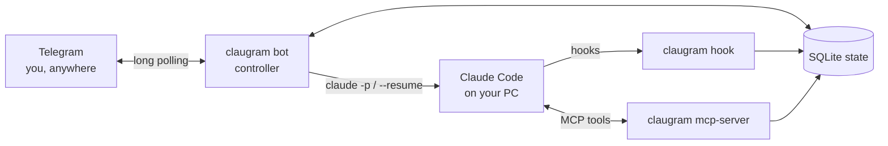

<h1 align="center">📱 claugram</h1>

<p align="center">
  <b>Claude Code ↔ Telegram bridge — remote control and human-in-the-loop for the Claude Code running on your own machine.</b><br/>
  Answer its questions, approve risky tool calls, get notified when it finishes, and start new work — from your phone.
</p>

<p align="center">
  
  
  
  
  
</p>

## Why

Agents are most useful when they keep working while you are away — and most dangerous when nobody can say "no".
claugram plugs into Claude Code's **official extension points** (lifecycle hooks, an MCP server, `claude -p` /
`--resume`) instead of screen-scraping a terminal, so a human stays in the loop wherever they are:

- ❓ **Ask** — Claude calls `ask_user_question`; you answer by replying in Telegram.
- 🛡️ **Approve** — `PermissionRequest` hooks turn risky tool calls into ✅/❌ buttons; force-pushes, pipe-to-shell and destructive deletes are denied outright.
- 🔔 **Notify** — edits, test runs and "done" summaries arrive tagged `project · session`.
- 🚀 **Drive** — `/code`, `/ask`, `/continue`, `/sessions` start or resume sessions in any registered repo.
- 🔒 **Safe by default** — chat-id whitelist, user-level token storage, secret redaction on everything sent, working-hours gating and a kill switch.



📖 Full guide (Vietnamese): [`docs/USAGE.vi.md`](docs/USAGE.vi.md) · design notes: [`docs/design-proposal.vi.md`](docs/design-proposal.vi.md)

## Install

```bash
pip install .          # or: pipx install .
cd /path/to/project
claugram init
```

`claugram init` walks you through: checking the `claude` CLI, configuring a
Telegram bot token + chat id, writing `.claugram/config.toml`, generating the
MCP config, patching `.claude/settings.local.json` with hooks, and inserting a
managed block into `CLAUDE.md`.

## Architecture

Four cooperating processes share one SQLite state DB
(`%APPDATA%\claugram\state.sqlite3` / `~/.config/claugram/state.sqlite3`):

| Piece | What it does |
| ----- | ------------ |
| `claugram bot` / `controller` | The **single** Telegram long-poller. Correlates replies/buttons to pending items and runs `/commands`. |
| `claugram mcp-server` | Launched by Claude Code. Exposes `notify_user`, `ask_user_question`, `request_permission`, `send_summary`, `get_pending_replies`. |
| `claugram hook <event>` | Called by Claude Code lifecycle hooks (PostToolUse, PermissionRequest, Notification, Stop, …). |
| controller worker | Inside the bot process; drains `/code` etc. jobs by running `claude -p`. |

The bot is the only process that calls `getUpdates`. MCP tools and hooks send a
Telegram message, then **poll the DB** for the answer the bot records.

## Everyday use

Run the bot (keep it running, or install as a service):

```bash
claugram bot --project .
```

Start Claude Code with the MCP server for interactive human-in-the-loop:

```bash
claude --mcp-config .claugram/mcp.claugram.json
```

From Telegram:

```
/code <task>     run Claude on a task in a FRESH session
/ask <question>  ask Claude (read-mostly, fresh session)
/continue <p>    resume the selected/last session, keeping context
/sessions        list Claude sessions in this project
/session <n|id>  pick a session to resume (none = clear selection)
/status /diff /test
/approve /deny   decide a pending permission
/done            let Claude stop
```

`/code` and `/ask` start a new Claude session each time (so `/sessions` shows
distinct entries). `/continue` resumes the last one — or, after `/session`,
the one you selected. This is how one project holds many sessions.

## Telling messages apart (project · session tags)

With one bot fielding many projects and sessions in a single chat, every
message is tagged with `<project> · <sess8>` — where `sess8` is the first 8
chars of the Claude session id, matching what `/sessions` shows:

```
🤖 agent-builder · 3427ce1b
✅ Edited file
- src/service.py

❓ agent-builder · 3427ce1b
Use approach A or B?
↩︎ Reply to this message to answer.

✅ agent-builder · 3427ce1b — Done (5 tool calls)
…
↩︎ Reply to continue · /session 3427ce1b
```

Reply routing:
- **Telegram "Reply"** on a specific message always answers *that* item exactly
  (correlated by message id) — the reliable way when several are in flight.
- A **plain** message answers the single waiting item. If more than one is
  waiting (across sessions/projects), the bot lists them with tags and asks you
  to Reply directly to the one you mean — so nothing is answered by mistake.

## Multiple projects (one bot, many repos)

Every `claugram init` registers its repo in the shared store. Run **one** bot
across all of them with:

```bash
claugram hub                 # primary = newest registered repo (for bot creds)
claugram hub --project ./a   # or pick the primary explicitly
```

`claugram bot --project .` behaves the same — the launched repo is just the
primary. In Telegram:

```
/projects        list registered repos (⭐ = this chat's active one)
/use <n|name>    switch this chat's active project
```

`/code`, `/ask`, `/continue`, `/sessions`, `/session`, `/status`, `/diff`,
`/test` all act on the chat's **active** project, and jobs are routed to that
project's own config and sessions. Each chat has its own active project, so
different people/chats can drive different repos through the same bot.

> One bot process = one Telegram token + whitelist (taken from the primary
> project). Point every repo you want on the hub at the same bot, then `/use`
> to move between them.

## Multiple sessions

A project can have many Claude sessions. `/sessions` lists them straight from
Claude Code's on-disk transcripts
(`~/.claude/projects/<slug>/<uuid>.jsonl`) — including sessions created before
claugram was installed. `/session <n|id>` marks one active; then `/code`,
`/ask` and `/continue` all resume that exact session with `claude --resume`.
`/session none` reverts to "most recent".

## Working-hours forwarding (schedule + kill switch)

By default every hook reaches Telegram. To restrict it, edit
`.claugram/config.toml`:

```toml
[schedule]
respect_schedule = true
active_days = ["mon", "tue", "wed", "thu", "fri"]
active_window = "09:00-18:00"
timezone = "Asia/Ho_Chi_Minh"
```

Now hooks only forward Mon–Fri 09:00–18:00. Two environment variables override
the schedule for the process running `claugram bot`:

- `CLAUGRAM_MUTE=1` — master off switch (never forward), for when you're away.
- `CLAUGRAM_ALWAYS=1` — force on, ignoring the schedule.

When forwarding is off: notifications/summaries are skipped, the Stop hook lets
Claude stop instead of waiting, and permission "ask" cases defer to Claude's own
local prompt (they are **not** auto-denied). Claude sessions themselves are
unaffected — only the Telegram bridge is gated. Check the current state with
`claugram status`.

## Safety

- Only whitelisted `chat_id`s are accepted.
- Bot token is stored user-level, never in the repo.
- All Telegram output is secret-redacted.
- Risky shell commands (force push, pipe-to-shell, disk format, deletes of
  root/home) are denied; installs/pushes/deploys require approval.
- No free-form `/cmd`. Claude chooses tools; hook policy controls permission.

Run `claugram doctor` any time to diagnose the setup.

## Verify locally (no Telegram needed)

Telegram is just the chat surface, behind a swappable transport. Set
`transport = "fake"` (or `CLAUGRAM_TRANSPORT=fake`) and messages go to a
file-backed `FakeTransport` you can inspect instead of the network.

```bash
pytest -q                      # 55 fast, deterministic tests
python samples/verify_live.py  # drives REAL claude sessions end-to-end
```

`samples/verify_live.py` copies `samples/hello-project` to a temp dir,
configures the fake transport, runs real Claude tasks through the controller,
and asserts: files created, PostToolUse hook notified, sessions discovered and
recorded, `/sessions` / `/session` / `/status` respond. Requires the `claude`
CLI; no bot token.

## Env auto-injection

`claugram init` writes an `env` block into `.claude/settings.local.json` so
hooks and the MCP server inherit `CLAUGRAM_PROJECT` (and `CLAUGRAM_TRANSPORT`
when using the fake transport) automatically — no manual `export`. Claude Code
applies this env to every hook/MCP process it spawns.
